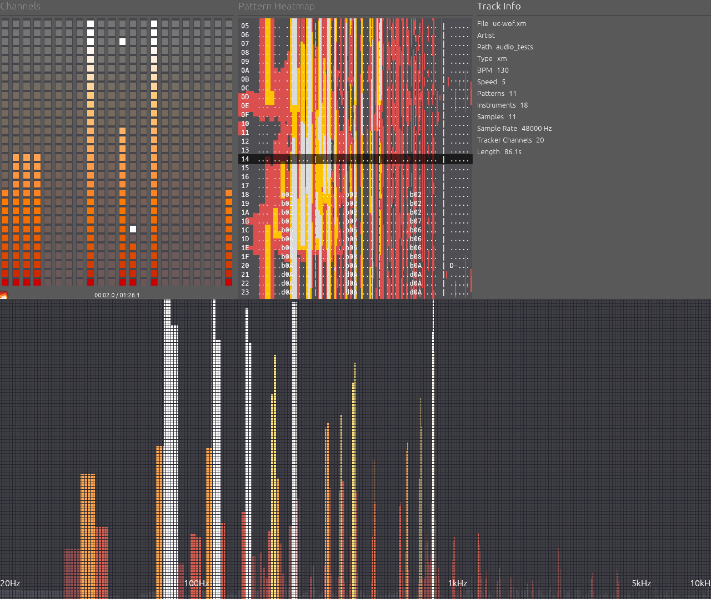
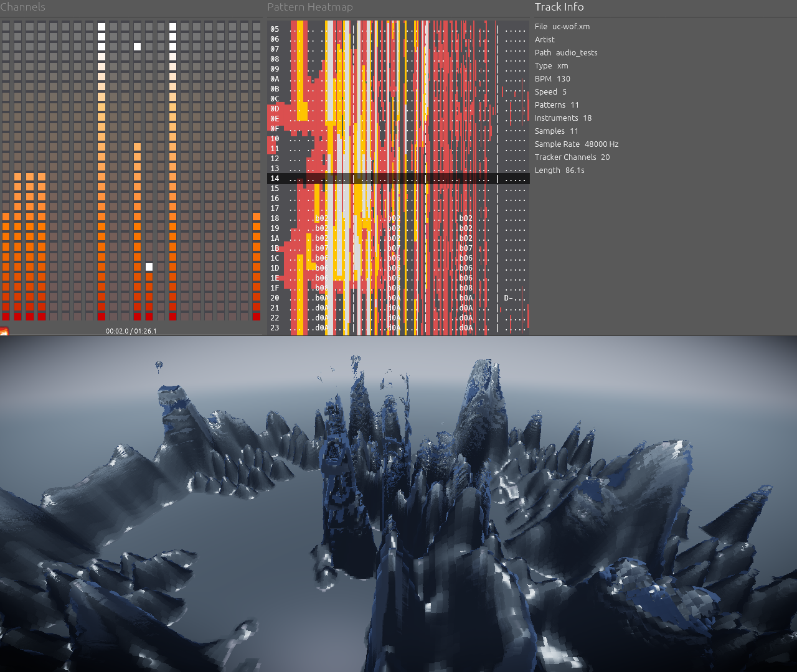
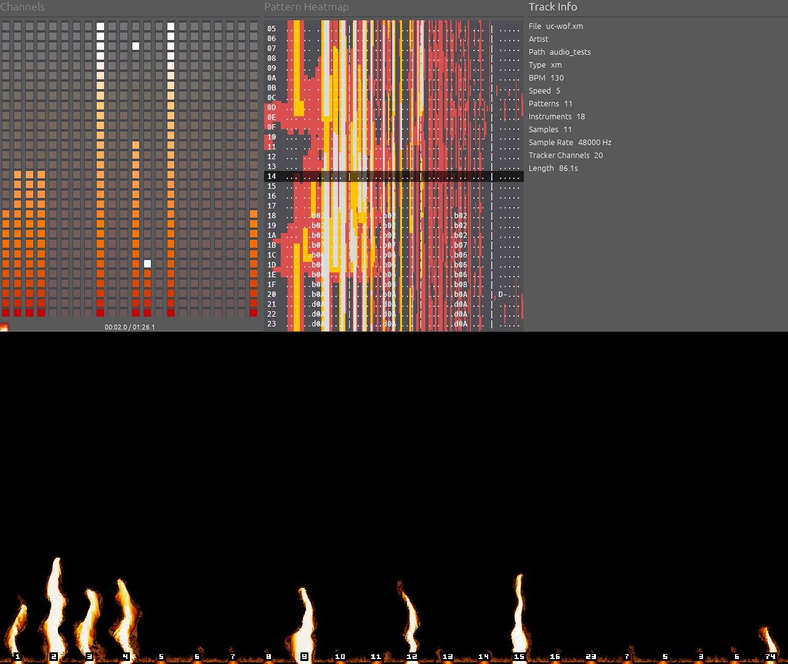
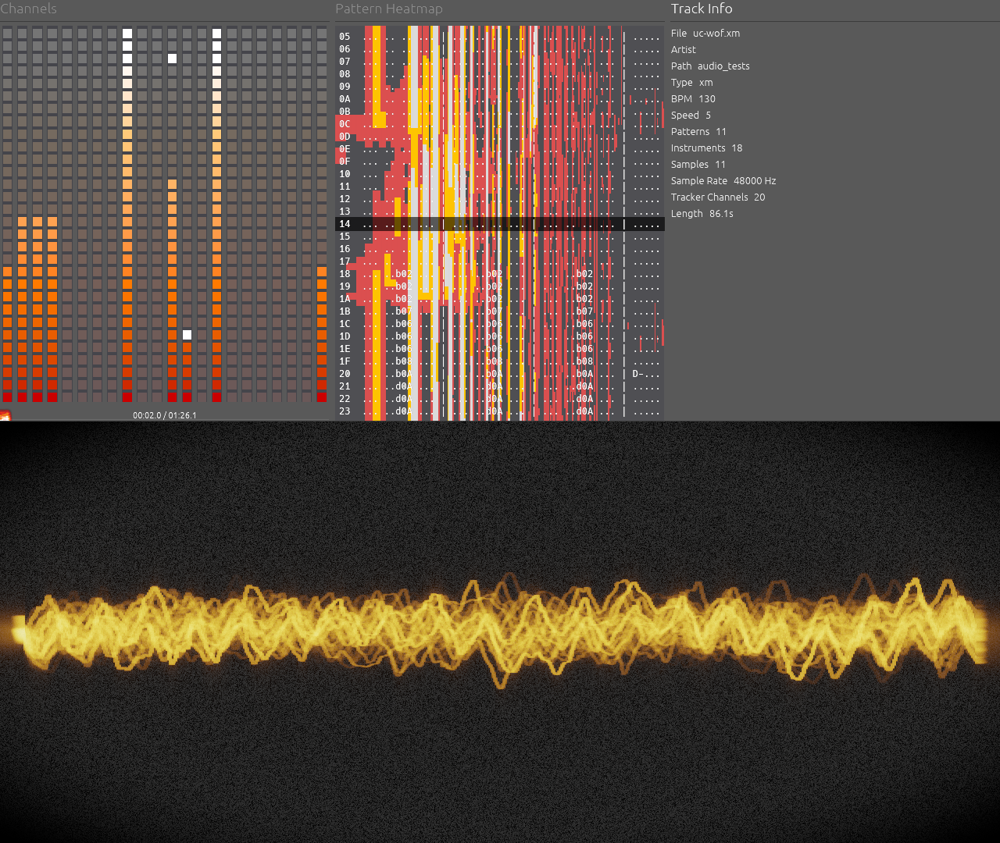

# RustTracker 🎵🦀



A high-performance, real-time audio visualizer, video player, and tracker module player built in Rust with Vulkan/WGPU hardware acceleration.

RustTracker leverages a **3-Thread DSP Architecture** and **Hardware-Accelerated Compute Shaders** to deliver ultra-low-latency playback and multi-channel spatial audio analysis at **2,000+ FPS**.

---

## 🚀 Features

* **21 Hardware Visualizers:** Cinematic WGPU compute and fragment shaders mapped tightly to acoustic frequencies (Ferrofluid, 3D Fire, 3D Synthwave Racer, 3D VU Meter Rack, 3D Glass Water Lyrics, Water Splash, CRT Oscilloscope, Bioluminescence, Neon Corridor, Matrix Rain, and more).
* **Multi-Platform Support:** Native support for **Linux (Fedora/RHEL & Ubuntu/Debian)**, **Android (Mobile & Tablet)**, **Windows 10/11**, **macOS**, and **Steam Deck (Gaming Mode)**.
* **Universal Media Playback:**
  * **Tracker Modules:** `.MOD`, `.S3M`, `.IT`, `.XM` with real-time piano-roll pattern editor and synchronized channel VU meters.
  * **Lossless & Compressed Audio:** FLAC, WAV, MP3, AAC, OGG, Opus, AIFF.
  * **Video Playback & Multi-Track Audio:** MP4, MKV, AVI, WebM with hardware-accelerated video decoding, HDR color spaces, and instant switching between multiple audio tracks (e.g., Vocals, Instrumental, Stems, Dubs).
  * **Bitstream Passthrough:** Real-time SPDIF/HDMI bitstream passthrough for Dolby Atmos, DTS-HD, and TrueHD.
  * **Live Microphone Input:** Instant audio-reactive capture via `--mic`.
* **Synchronized Lyrics & Heatmap:** Embedded and LRC synchronized lyrics with real-time heatmaps and 3D vector TrueType glyph extrusion.
* **Intuitive Touch & Gamepad Controls:** Tailored touch gestures for mobile screens and native controller mapping for Steam Deck / Gamepads.

---

## 🎨 Visualizations

| Photorealistic Ferrofluid | Multi-Channel 3D Fire |
| :---: | :---: |
|  |  |

| CRT Oscilloscope | Frequency Spectrum |
| :---: | :---: |
|  |  |

---

## 📱 Mobile Gestures (Android)

RustTracker features a specialized dual-pane interface optimized for mobile and tablet displays:

### Portrait Mode (Two-Pane Layout)
* **Top Pane (Upper 50% — HUD / Track / Video):**
  * **Swipe Left / Right:** Cycle HUD tabs (`Channels` ➔ `Heatmap / Lyrics` ➔ `Track Info` ➔ `Video Stream`).
  * **Swipe Up:** Expand to **Fullscreen Video** *(when video stream is active)*.
  * **Swipe Down:** Exit Fullscreen Video back to 50/50 split view.
* **Bottom Pane (Lower 50% — Real-Time Visualizer):**
  * **Swipe Left / Right:** Switch to next / previous visualizer module.
* **Bottom Scrubber Edge (Bottom 12%):**
  * **Touch & Drag:** Real-time interactive timeline seeking across track duration.

### Landscape Mode (Full-Screen Visualizer)
* **Swipe Left / Right:** Switch visualizers.
* **Swipe Up / Down:** Rotate HUD overlays (`Channels`, `Heatmap / Lyrics`, `Track Info`, `Video`).

### Universal Gestures (Both Orientations)
* **Single Tap:** **Play / Pause** toggle *(or tap top-right `[📂 OPEN]` for system file picker)*.
* **Double Tap:** Toggle **HUD Visibility** (`HUD: Visible` / `HUD: Hidden`).
* **Two-Finger Tap:** **Cycle Audio Track** on multi-track media files.

---

## 🎮 Desktop & Gamepad Controls

| Action | Desktop Key | Gamepad (Xbox / Steam Deck) |
| :--- | :--- | :--- |
| **Play / Pause** | `Space` | `A` (`South`) or `Start` |
| **Seek Backward / Forward** | `Left` / `Right` Arrow (`Shift` ±30s, `Ctrl`/`⌘` ±60s) | `Left Trigger (LT)` / `Right Trigger (RT)` (analog scrub) |
| **Step Frame Backward / Forward** | `,` / `.` | — |
| **Prev / Next Track** | `P` / `N` | `D-Pad Left` / `D-Pad Right` |
| **Prev / Next Visualizer** | `Up` / `Down` Arrow | `D-Pad Up` / `D-Pad Down` |
| **Visualizer Picker Popup** | `M` | `Y` (`North Button`) |
| **Toggle Video / Cycle View Mode** | `V` | `Right Bumper (RB)` |
| **Toggle HUD Visibility** | `Tab` | `B` (`East Button`) |
| **Resize HUD / Visualizer Split** | `[` / `]` | — |
| **Select Audio Track (1–9)** | `1` – `9` | `Right Stick Click (R3)` (cycles track) |
| **Toggle Performance Stats** | `S` | `Select / Back Button` |
| **Toggle Keyboard / Gamepad Help** | `H` | `Left Bumper (LB)` |
| **Open File Dialog** | `O` | `X` (`West Button`) |
| **Toggle GPU Compute FFT** | `G` | `Left Stick Click (L3)` |
| **Fullscreen Toggle** | `F` | — |
| **Quit** | `Ctrl+Q` / `⌘Q` or `Escape` | — |

---

## ⚙️ Command-Line Options & Environment Variables

### Command-Line Flags
* **`--tui`**: Launch in terminal UI (TUI) spectrum analyzer and tracker mode.
* **`--mic`**: Capture live microphone input instead of playing a file.
* **`--vis <id>`**: Start directly on the specified hardware visualizer ID.
* **`--uncapped`**: Disable VSync/refresh-rate pacing and run at uncapped hardware frame rates (`Immediate` present mode).
* **`--bench [frames]`**: Run automated benchmark loop for a given frame count (default `300`) with GPU timestamp profiling enabled.
* **`--fullscreen` / `--windowed`**: Force fullscreen or windowed startup mode.

### Environment Variables
* **`RUSTTRACKER_FPS_LIMIT=<fps>`**: Set an explicit software framerate cap (e.g. `RUSTTRACKER_FPS_LIMIT=120`). By default, RustTracker paces to the active display refresh rate (or VSync).
* **`RUSTTRACKER_PROFILE=1`**: Enables GPU hardware timestamp profiling (`wgpu::Features::TIMESTAMP_QUERY`) in the Stats overlay (`S` key) to measure exact per-shader microsecond timings.
* **`RUSTTRACKER_PRESENT_MODE=<fifo|mailbox|immediate>`**: Override the WGPU surface present mode.
* **`RUSTTRACKER_PIPELINE_CACHE=0`**: Disable on-disk Vulkan/WGPU pipeline cache loading and saving.

---

## 📦 Installation & Download

Pre-compiled packages for all platforms are available on the [GitHub Releases](https://github.com/Soddentrough/rusttracker/releases) page:

* **Android:** Download and install `app-release.apk` (or `RustTracker-Android-*.apk`).
* **Windows:** Download and run `RustTracker-Setup.exe` installer.
* **macOS (Apple Silicon, macOS 11.0+):** Download and open `RustTracker-MacOS-Installer.dmg`, then drag `RustTracker.app` to `/Applications`. *(If macOS Gatekeeper warns that the app is unverified on first launch, run `xattr -cr /Applications/RustTracker.app` or Right-Click ➔ **Open**).*
* **Fedora / RHEL:** `sudo dnf install ./rusttracker-*.x86_64.rpm`
* **Ubuntu / Debian:** `sudo dpkg -i ./rusttracker_*_amd64.deb`
* **Steam Deck:** Download `RustTracker-SteamDeck-*.AppImage`, mark executable, and add as Non-Steam Game in Steam Gaming Mode.

---

## 🛠️ Building from Source

### Prerequisites
* Rust 1.85+ (Edition 2024)
* GPU Drivers: Vulkan SDK / Drivers (`vulkan-loader`, `mesa-vulkan-drivers`) on Linux/Windows, or Metal on macOS
* FFmpeg 6.0+ libraries & `libopenmpt`

### Linux (Fedora)
```bash
sudo dnf install -y gcc gcc-c++ binutils pkgconfig alsa-lib-devel wayland-devel libX11-devel libxkbcommon-devel systemd-devel ffmpeg-devel libopenmpt-devel clang clang-devel
cargo build --release
```

### macOS (Homebrew)
```bash
brew install ffmpeg@7 libopenmpt
brew link --overwrite --force ffmpeg@7
export PKG_CONFIG_PATH="/opt/homebrew/opt/ffmpeg@7/lib/pkgconfig:/opt/homebrew/lib/pkgconfig"
export LIBRARY_PATH="/opt/homebrew/opt/ffmpeg@7/lib:/opt/homebrew/lib"
export CPATH="/opt/homebrew/opt/ffmpeg@7/include:/opt/homebrew/include"
export BINDGEN_EXTRA_CLANG_ARGS="-I/opt/homebrew/opt/ffmpeg@7/include -I/opt/homebrew/include"
cargo build --release
```

### Android (APK)
```bash
# Requires Android SDK + NDK and cargo-ndk
cargo install cargo-ndk
rustup target add aarch64-linux-android
cd android && ./gradlew assembleRelease
```

---

## 📜 License

This project is licensed under the [GNU General Public License v3.0](LICENSE) (GPLv3).

