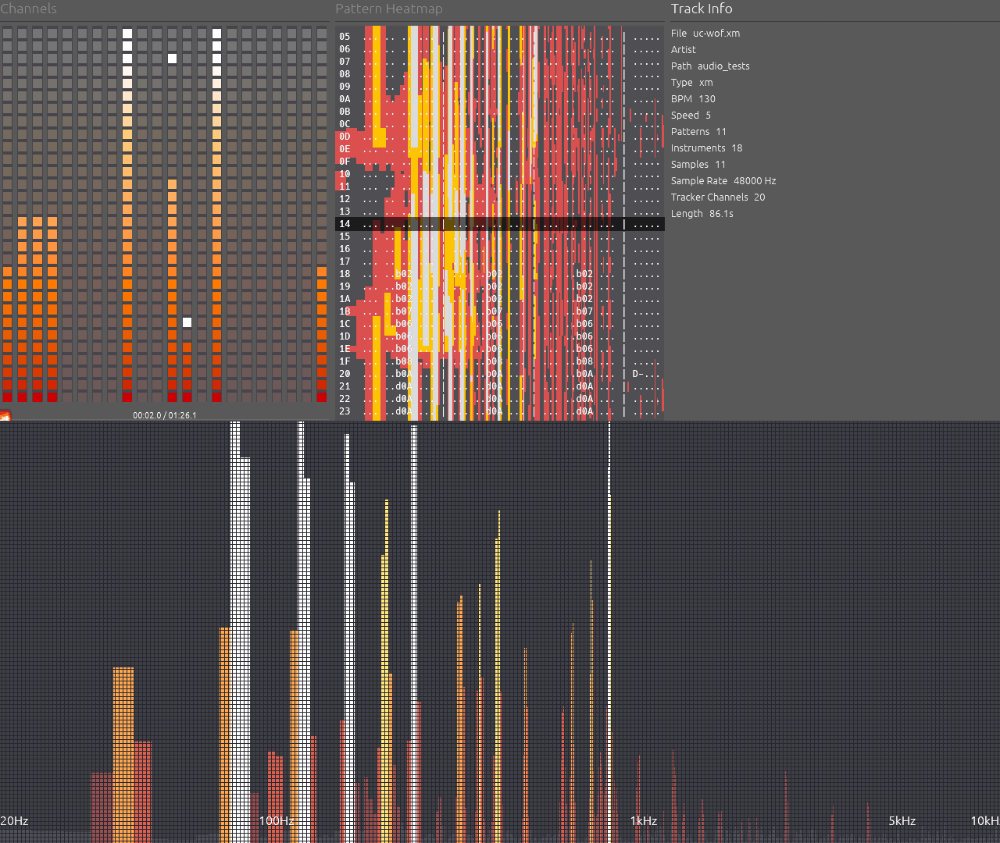
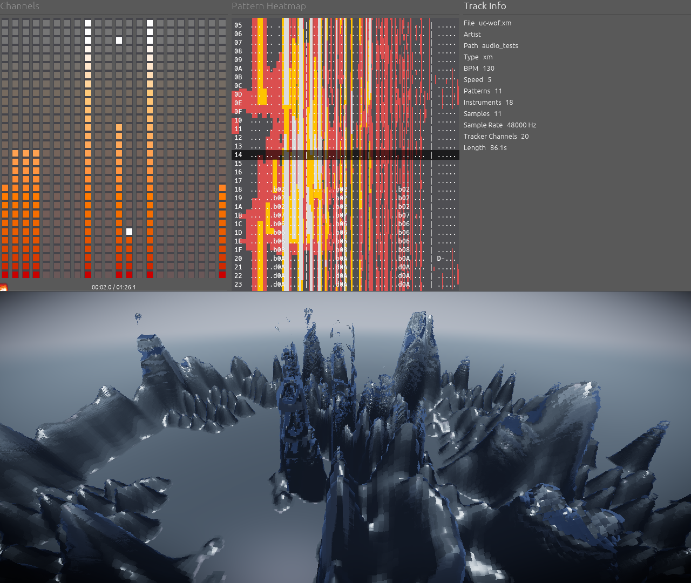
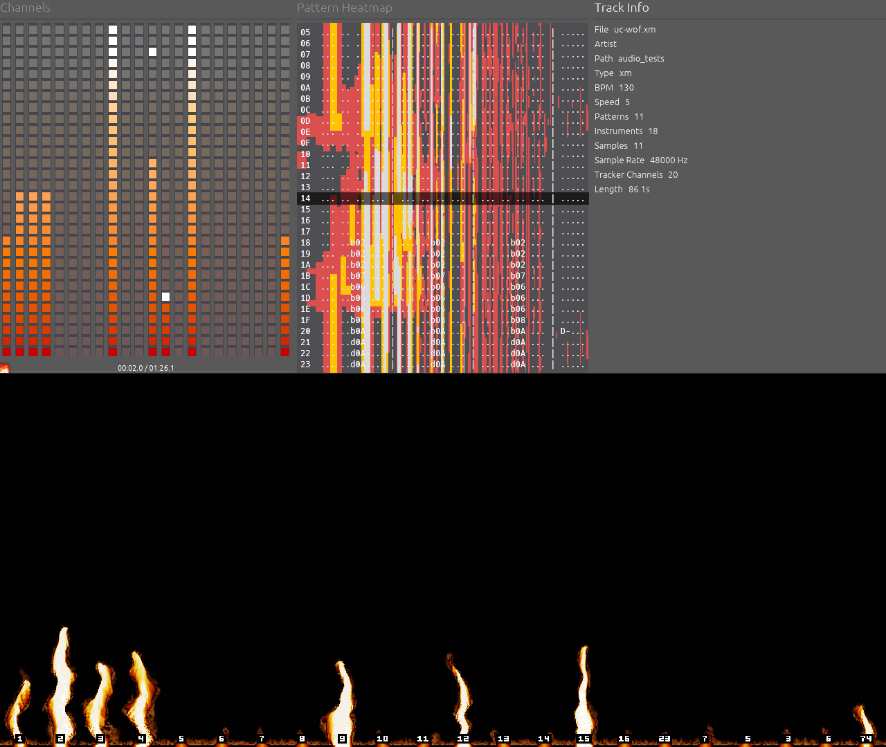
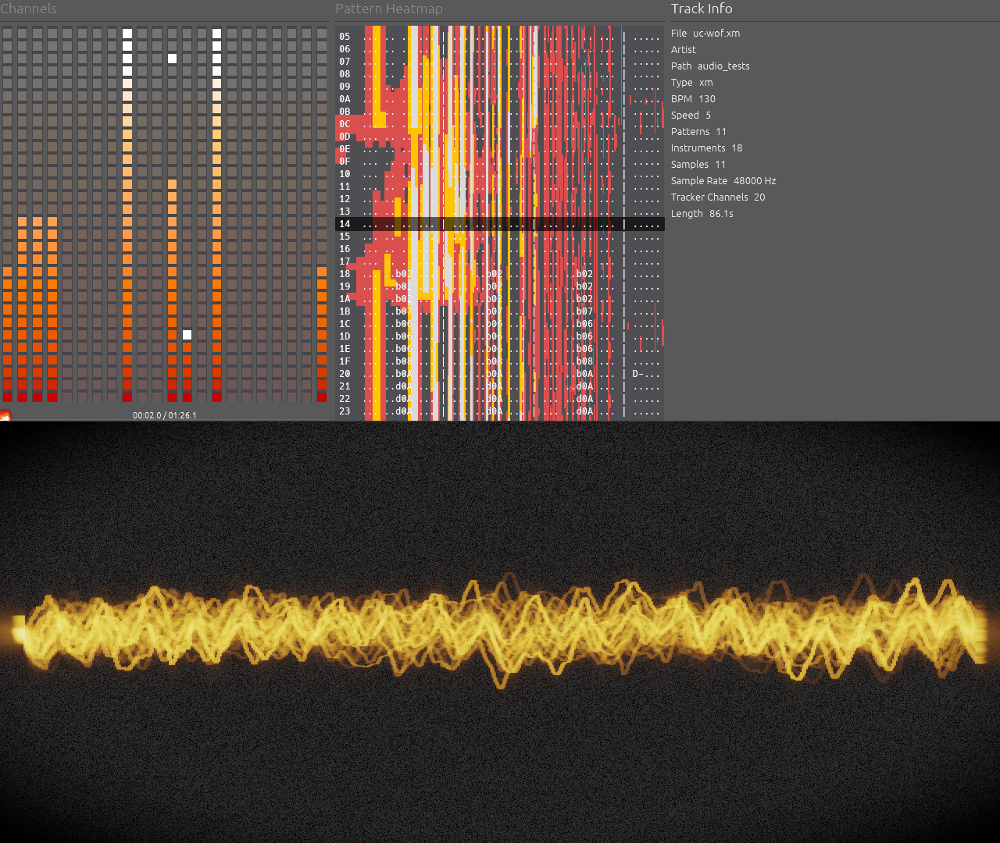
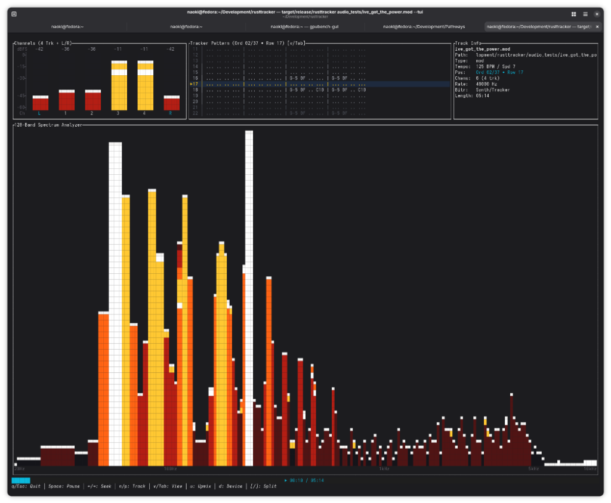

# RustTracker 🎵🦀



A high-performance, real-time audio visualizer, video player, and tracker module player built in Rust with Vulkan/WGPU hardware acceleration.

RustTracker pairs a **multi-threaded audio/video/DSP pipeline** (dedicated demux/audio decode, optional video decode, lock-free real-time audio output, FFT/DSP analysis, and WGPU render threads) with **hardware-accelerated compute and fragment shaders**, pacing cleanly to your display refresh rate by default (with `--uncapped` available for uncapped GPU benchmarking).

---

## 🚀 Features

* **19 Hardware Visualizers (16 in Default Rotation):** Cinematic WGPU compute and fragment shaders mapped to real-time acoustic frequencies (`Quantum FLIP Ferrofluid`, `Acoustic Glass Water Chamber`, `3D Glass Water Lyrics`, `Prismatic Spectrum Canyon`, `Synthwave 3D Racer`, `Synthwave Terrain`, `Retro VU Meters`, `Bioluminescent Waves`, `Neon Spatial Room`, `Midnight Storm`, `Solar Flare`, `Fire Simulation`, `Retro Fire`, `CRT Oscilloscope`, `3D Oscilloscope`, `Strings`, `Retro Tape Head`, `Studio LED Spectrum`, and `Frequency Spectrum`).
* **Multi-Platform Support:** Native support for **Linux (Fedora/RHEL & Ubuntu/Debian)**, **Android (Mobile & Tablet)**, **Windows 10/11**, **macOS**, and **Steam Deck (Gaming Mode)**.
* **Universal Media Playback:**
  * **Tracker Modules:** `.MOD`, `.S3M`, `.IT`, `.XM` with real-time tracker pattern viewer and synchronized channel VU meters.
  * **Lossless & Compressed Audio:** FLAC, WAV, MP3, AAC, OGG, Opus, AIFF.
  * **Video Playback & Multi-Track Audio:** MP4, MKV, AVI, WebM with hardware-accelerated video decoding, HDR10/HLG tonemapping to SDR, and instant switching between multiple audio tracks (e.g., Vocals, Instrumental, Stems, Dubs).
  * **Bitstream Passthrough:** Real-time SPDIF/HDMI bitstream passthrough for Dolby Atmos, DTS-HD, and TrueHD on Linux (PipeWire/ALSA) and Windows (WASAPI Exclusive).
  * **Live Microphone Input:** Instant audio-reactive capture via `--mic`.
* **Synchronized Lyrics & Heatmap:** Embedded and LRC synchronized lyrics with real-time heatmaps and 3D vector TrueType glyph extrusion.
* **Intuitive Touch & Gamepad Controls:** Tailored touch gestures for mobile and touchscreen displays, plus native controller mapping for Steam Deck / Gamepads.

---

## 🎨 Visualizations

| Photorealistic Ferrofluid | Multi-Channel 3D Fire |
| :---: | :---: |
|  |  |

| CRT Oscilloscope | Frequency Spectrum |
| :---: | :---: |
|  |  |

---

## 🖥️ Terminal UI Mode (`--tui`)

Launch RustTracker directly in any terminal with `--tui` for a headless, zero-GPU-overhead studio interface featuring multi-column dBFS channel VU meters, real-time tracker pattern viewer, synced lyrics, spectrogram heatmap, interactive surround EQ controls, a 128-band logarithmic spectrum analyzer, and full keyboard + mouse controls:

```bash
rusttracker audio_tests/ive_got_the_power.mod --tui
```



| Action | TUI Key / Mouse |
| :--- | :--- |
| **Play / Pause** | `Space` |
| **Seek Backward / Forward** | `Left` / `Right` Arrow (`Shift` ±30s, `Ctrl` ±60s) or **Click / Drag Timeline** |
| **Prev / Next Track** | `P` / `N` |
| **Cycle Top-Center View** (`Lyrics` ➔ `Tracker Pattern` ➔ `Heatmap` ➔ `Surround EQ`) | `V` / `Tab` or **Click Center Panel** |
| **Toggle Surround Upmix / 7.1.4 MPEG-H / Reset EQ** | `U` (or `E`) / `M` (in EQ view) / `R` (in EQ view) |
| **Toggle Bitstream Passthrough** *(Linux / Windows)* | `B` |
| **Volume / Mute** | `+` / `-` (or **Mouse Scroll Wheel**) / `M` |
| **Solo Audio Track / Restore Multi-Track Mix** | `1` – `9` |
| **Audio Input / Output Device Picker** | `D` |
| **Resize Top / Spectrum Split** | `[` / `]` or **Drag Horizontal Split Border** |
| **Quit** | `Q` / `Esc` / `Ctrl+C` |

---

## 📱 Touch Gestures (Android & Touchscreens)

RustTracker features a specialized dual-pane touch interface optimized for mobile and tablet displays, with bottom-edge timeline touch-scrubbing also active on desktop and Steam Deck touchscreens:

### Portrait Mode (Two-Pane Layout)
* **Top Pane (Upper 50% — HUD / Track / Video):**
  * **Swipe Left / Right:** Cycle HUD tabs (`Channels` ➔ `Heatmap / Lyrics` ➔ `Track Info` ➔ `Video Stream`).
  * **Swipe Up:** Expand to **Fullscreen Video** *(when video stream is active)*.
  * **Swipe Down:** Exit Fullscreen Video back to 50/50 split view.
* **Bottom Pane (Lower 50% — Real-Time Visualizer):**
  * **Swipe Left / Right:** Switch to next / previous visualizer module.
* **Bottom Scrubber Edge (Bottom 12%):**
  * **Touch & Drag:** Real-time timeline seeking across track duration *(Android, Steam Deck, and desktop touchscreens)*.

### Landscape Mode (Full-Screen Visualizer)
* **Swipe Left / Right:** Switch visualizers.
* **Swipe Up / Down:** Rotate HUD overlays (`Channels`, `Heatmap / Lyrics`, `Track Info`, `Video`).

### Universal Gestures (Android, Both Orientations)
* **Single Tap:** **Play / Pause** toggle *(or tap top-right `[📂 OPEN]` for system file picker)*.
* **Double Tap:** Toggle **HUD Visibility** (`HUD: Visible` / `HUD: Hidden`).
* **Two-Finger Tap:** **Cycle Audio Track** on multi-track media files.
* **Three-Finger Tap:** Toggle **Engine Performance Stats** (`Engine Stats: Visible` / `Hidden`).

---

## 🎮 Desktop & Gamepad Controls

| Action | Desktop Key | Gamepad (Xbox / Steam Deck) |
| :--- | :--- | :--- |
| **Play / Pause** | `Space` | `A` (`South`) *(or Open File on Splash)* |
| **Open File Dialog** | `O` | `Y` (`North`) *(or `A` on Splash Screen)* |
| **Toggle Performance Stats** | `S` | `B` (`East`) *(also closes modals)* |
| **Toggle Video / Cycle View Mode** | `V` | `X` (`West`) |
| **Prev / Next Track** | `P` / `N` | `L1` / `R1` (`Left / Right Bumper`, or ±60s seek) |
| **Seek Backward / Forward** | `Left` / `Right` Arrow (±5s, `Shift` ±30s, `Ctrl`/`⌘` ±60s) | `D-Pad Left` / `D-Pad Right` (±10s) or `L2` / `R2` (analog scrub) |
| **Step Frame Backward / Forward** | `,` / `.` | — |
| **Cycle Visualizer** | `Up` / `Down` Arrow | `D-Pad Up` / `D-Pad Down` |
| **Visualizer Picker Popup** | `M` | — |
| **Toggle HUD Visibility** | `Tab` | `L3` (`Left Stick Click`) |
| **Toggle Surround Upmix** | `U` (or `E`) | `R3` (`Right Stick Click`) |
| **Resize HUD / Visualizer Split** | `[` / `]` | `Left Stick` or `Right Stick` (Up / Down) |
| **Select / Solo Audio Track or Restore Mix (1–9)** | `1` – `9` | — |
| **Toggle Camera Mode** *(Bioluminescent Waves)* | `C` | — |
| **Toggle Keyboard / Gamepad Help** | `H` | — |
| **Fullscreen Toggle** | `F` | `Start` |
| **Quit** | `Ctrl+Q` / `⌘Q` or `Escape` | `Select / View` |

---

## ⚙️ Command-Line Options & Environment Variables

### Command-Line Flags
* **`--tui`**: Launch in terminal UI (TUI) spectrum analyzer and tracker viewer mode.
* **`--mic`**: Capture live microphone/line-in audio instead of playing a file.
* **`--vis <id|name>`**: Start directly on the specified hardware visualizer ID or name (or pass bare `--vis` / `--vis list` to list visualizers and exit).
* **`--list-vis`**: List all 19 available hardware visualizers (IDs, names, and descriptions) and exit.
* **`--stereo`**: Force 2.0 stereo downmix output even on multi-channel hardware endpoints.
* **`--passthrough`**: Enable compressed SPDIF/HDMI bitstream passthrough (AC-3, E-AC-3/Atmos, DTS-HD, TrueHD) on Linux and Windows.
* **`--surround-upmix`** / **`--no-surround-upmix`** *(aliases `--upmix` / `--no-upmix`)*: Enable (default) or disable automatic surround/height upmixing when >2ch hardware output is available.
* **`--mpegh`** / **`--no-mpegh`** *(alias `--mpegh-714`)*: Enable (default) or disable 7.1.4 (11.1) MPEG-H 3D Audio HDMI bitstream encoding on >8ch capable Linux (PipeWire) and Windows (WASAPI Exclusive fallback) endpoints.
* **`--fullscreen`** / **`--windowed`**: Force fullscreen or windowed startup mode (mutually exclusive).
* **`--uncapped`**: Disable VSync/refresh-rate pacing and run at uncapped hardware frame rates (`AutoNoVsync` / `Immediate` present mode).
* **`--bench [frames]`**: Run automated benchmark loop for a given frame count (default `300` when omitted) with GPU timestamp profiling enabled.
* **`--register-steam`**: Headlessly register or update **RustTracker** in Steam's `shortcuts.vdf`, provision all SteamOS Home Screen & Library artwork (`config/grid/` and `appcache/librarycache/`), restart `steam-launcher.service` if active, and exit (ideal for one-step SSH deployment).

### Environment Variables
* **`RUSTTRACKER_FPS_LIMIT=<fps>`**: Set an explicit software framerate cap (e.g. `RUSTTRACKER_FPS_LIMIT=120`). By default, RustTracker paces to the active display refresh rate (or VSync).
* **`RUSTTRACKER_PROFILE=1`**: Enables GPU hardware timestamp profiling (`wgpu::Features::TIMESTAMP_QUERY`) in the Stats overlay (`S` key) to measure exact per-shader microsecond timings.
* **`RUSTTRACKER_PRESENT_MODE=<fifo|fiforelaxed|mailbox|immediate>`**: Override the WGPU surface present mode.
* **`RUSTTRACKER_PIPELINE_CACHE=0`**: Disable on-disk Vulkan/WGPU pipeline cache loading and saving.
* **`RUSTTRACKER_CACHE_DIR=<path>`**: Override the directory where compiled WGPU pipeline caches (`pipeline_cache_<key>.bin`) are stored.
* **`RUSTTRACKER_WAYLAND=0`** / **`RUSTTRACKER_X11=1`**: Force the X11/XWayland display backend on Linux. By default, RustTracker uses the native **Wayland** backend whenever `WAYLAND_DISPLAY` is active and falls back to X11 when `WAYLAND_DISPLAY` is absent (set `RUSTTRACKER_X11=1` or `RUSTTRACKER_WAYLAND=0` if you specifically need X11/XWayland windowing).

---

## 📦 Installation & Download

Pre-compiled packages for all platforms are available on the [GitHub Releases](https://github.com/Soddentrough/rusttracker/releases) page:

* **Android:** Download and install `app-release.apk` (or `RustTracker-Android-*.apk`).
* **Windows:** Download and run `RustTracker-Setup.exe` installer.
* **macOS (Apple Silicon, macOS 11.0+):** Download and open `RustTracker-MacOS-Installer.dmg`, then drag `RustTracker.app` to `/Applications`. *(If macOS Gatekeeper warns that the app is unverified on first launch, run `xattr -cr /Applications/RustTracker.app` or Right-Click ➔ **Open**).*
* **Fedora / RHEL:** `sudo dnf install ./rusttracker-*.x86_64.rpm`
* **Ubuntu / Debian:** `sudo dpkg -i ./rusttracker_*_amd64.deb`
* **Steam Deck / SteamOS:** Download `RustTracker-SteamDeck-*.AppImage` and follow the steps below.

### 🕹️ Steam Deck / SteamOS Installation Procedure

You can install RustTracker on a Steam Deck either **remotely over SSH** (without leaving Gaming Mode) or **directly on the device in Desktop Mode**.

#### Option A: Remote Deployment via SSH (No Desktop Mode Required)
If `sshd` is enabled on your Steam Deck (`passwd` set and `sudo systemctl enable --now sshd`), you can copy the AppImage from your PC and headlessly register it in Steam Gaming Mode with two commands:
```bash
# 1. Copy the AppImage to the Steam Deck
scp RustTracker-SteamDeck-*.AppImage deck@<steamdeck-ip>:~/Downloads/RustTracker-SteamDeck.AppImage

# 2. Mark executable and headlessly register the Non-Steam shortcut + Home Screen artwork
ssh deck@<steamdeck-ip> "chmod +x ~/Downloads/RustTracker-SteamDeck.AppImage && ~/Downloads/RustTracker-SteamDeck.AppImage --register-steam"
```
`--register-steam` automatically stops `steam-launcher.service` cleanly, creates or updates the **`RustTracker`** entry in `~/.local/share/Steam/userdata/*/config/shortcuts.vdf`, installs the 512×512 icon, provisions all Steam Grid & LibraryCache artwork (`config/grid/` and `appcache/librarycache/`), and restarts `steam-launcher.service` so **RustTracker** immediately appears on the SteamOS Home Screen.

#### Option B: On-Device Setup (Desktop Mode)
1. **Switch to Desktop Mode:** Press the `STEAM` button ➔ **Power** ➔ **Switch to Desktop**.
2. **Download & Mark Executable:** Download `RustTracker-SteamDeck-*.AppImage` (e.g., into `~/Downloads` or `~/Applications`) and mark it executable:
   ```bash
   chmod +x ~/Downloads/RustTracker-SteamDeck-*.AppImage
   ```
3. **Register Shortcut & Artwork Automatically (or via Steam UI):**
   * **Fastest (Terminal / Konsole):** Run `./RustTracker-SteamDeck-*.AppImage --register-steam` to automatically add **`RustTracker`** to Steam with all Home Screen artwork and icons pre-configured.
   * **Via Steam UI:** Launch the AppImage once (which provisions `~/.local/share/icons/hicolor/512x512/apps/rusttracker.png` and `~/.local/share/applications/com.soddentrough.rusttracker.desktop`), then open **Steam** ➔ **Games** ➔ **Add a Non-Steam Game to My Library...**, select **`RustTracker`**, and click **Add Selected Programs**. *(Even if you add the `.AppImage` file directly via **Browse...**, launching RustTracker automatically normalizes the shortcut's `AppName` to **`RustTracker`** and provisions the bundled Steam Grid & LibraryCache artwork).*
4. **Return to Gaming Mode:** Switch back to **Gaming Mode**. **RustTracker** will appear on your SteamOS Home Screen and Library with full artwork, native `1280×800` Gamescope scaling, and full gamepad controls.

---

## 🛠️ Building from Source

### Prerequisites
* Rust 1.85+ (Edition 2024)
* GPU Drivers: Vulkan SDK / Drivers (`vulkan-loader`, `mesa-vulkan-drivers`) on Linux/Windows, or Metal on macOS
* FFmpeg 6.0+ libraries & `libopenmpt`

### Linux (Fedora) & Steam Deck AppImage
```bash
sudo dnf install -y gcc gcc-c++ binutils pkgconfig alsa-lib-devel wayland-devel libX11-devel libxkbcommon-devel systemd-devel ffmpeg-devel libopenmpt-devel clang clang-devel
cargo build --release

# Optional: Package standalone Steam Deck / Linux AppImage (bundles FFmpeg, libopenmpt, SoundFont, and SteamGrid assets)
./repackage_appimage.sh
```

### macOS (Homebrew)
```bash
brew install ffmpeg@7 libopenmpt
brew link --overwrite --force ffmpeg@7
export PKG_CONFIG_PATH="/opt/homebrew/opt/ffmpeg@7/lib/pkgconfig:/opt/homebrew/lib/pkgconfig"
export LIBRARY_PATH="/opt/homebrew/opt/ffmpeg@7/lib:/opt/homebrew/lib"
export CPATH="/opt/homebrew/opt/ffmpeg@7/include:/opt/homebrew/include"
export BINDGEN_EXTRA_CLANG_ARGS="-I/opt/homebrew/opt/ffmpeg@7/include -I/opt/homebrew/include"
cargo build --release
```

### Android (APK)
```bash
# Requires Android SDK + NDK and cargo-ndk
cargo install cargo-ndk
rustup target add aarch64-linux-android
cd android && ./gradlew assembleRelease
```

---

## 📜 License

This project is licensed under the **[GNU General Public License v3.0 or later](LICENSE)** (`GPL-3.0-or-later`) with a **GNU GPLv3 Section 7 Additional Permission (Linking Exception)** for `libmpeghe`:

* **`libmpeghe` (`third_party/libmpeghe`):** Licensed by Ittiam Systems Pvt. Ltd. under `BSD-3-Clause-Clear` ([`LICENSE`](third_party/libmpeghe/LICENSE) and [`LICENSE2`](third_party/libmpeghe/LICENSE2)). Under Section 7 of GNU GPLv3, RustTracker's copyright holders grant explicit additional permission to link and convey RustTracker alongside `libmpeghe`, provided binary distributions include [`THIRD_PARTY_NOTICES.txt`](THIRD_PARTY_NOTICES.txt) reproducing Ittiam's `LICENSE` and `LICENSE2` notices. Note that `libmpeghe` explicitly grants no third-party patent licenses; commercial or patent-restricted deployments should evaluate applicable MPEG-H 3D Audio patent licensing independently.
* **Third-Party Bundled Libraries (`FFmpeg`, `libopenmpt`):** Standalone redistributables (Windows installer, macOS `.dmg`, SteamOS `.AppImage`, and Android `.apk`) bundle [`THIRD_PARTY_NOTICES.txt`](THIRD_PARTY_NOTICES.txt). When redistributing standalone bundles containing FFmpeg (`LGPL-2.1-or-later`, or `GPL-3.0-or-later` if built with `--enable-gpl`), retain [`LICENSE`](LICENSE) and [`THIRD_PARTY_NOTICES.txt`](THIRD_PARTY_NOTICES.txt), avoid `--enable-nonfree` FFmpeg builds, and preserve dynamic library replaceability (or provide corresponding FFmpeg source archives matching the bundled version).
